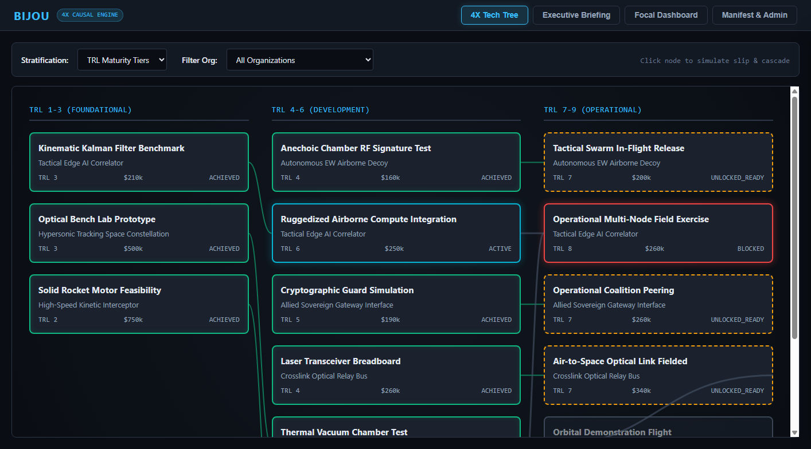

# Bijou

**Multi-Echelon Impact & Causal Graph Engine**

[](https://www.python.org/)
[](LICENSE)
[]()
[](https://github.com/astral-sh/ruff)
[]()

---

## Overview

**Bijou** is an offline-capable, multi-echelon strategic causal graph and decision-support engine designed for complex capital acquisition portfolios, defense architectures, and mission-critical systems engineering.

Rather than relying on static roadmaps or unweighted dependencies, Bijou models the non-linear ripple effects of technology slips, budget cuts, and architectural trade-offs using rigorous causal graph projections, Critical Path Method (CPM) schedule slack propagation, Pareto optimal frontier evaluation, and real-time operational telemetry rollups.



---

## Key Capabilities

1. **4X-Style Stratified Tech Tree**:
   - Interactive dependency matrix supporting **TRL Maturity Tiers**, **Fiscal Eras**, and **Topological Depths**.
   - Dynamic SVG connector overlays with orthogonal routing and upstream critical-path spine highlighting.
2. **What-If Milestone Slip Simulator & Decision Provenance Ledger**:
   - Slack-aware Critical Path Method (CPM) simulation: minor slips are absorbed by downstream slack; critical slips cascade across prerequisites.
   - Computes exact downstream blast radius: impacted milestone states (`BLOCKED`, `LOCKED`, `ACTIVE`), degraded effects, broken strategic concerns, and portfolio ROI delta.
   - **Decision Provenance Ledger (`REC-019`)**: Thread-safe SQLite WAL audit log capturing decision author, timestamp, and strategic rationale directly from the slip drawer.
3. **Multi-Perspective Sovereign Briefing**:
   - Instant 1-slide executive briefing evaluated from any organization's sovereign viewpoint.
   - 4-quadrant layout: Supported Strategic Concerns, Owned Things, Cross-Organizational Dependencies, and Total Committed Cost with executive narrative synthesis.
   - Built-in print stylesheet for landscape executive PDF/print generation.
4. **Single-Thing 2-Hop Concentric Radial Ego-Network (`REC-013`)**:
   - Interactive HTML5 `<canvas>` rendering 2-hop concentric radial graphs: Focal center, 1-hop upstream predecessors (inner-left), 1-hop downstream dependents (inner-right), and 2-hop produced effects (outer-right).
   - Ingests analytical telemetry events via embedded DuckDB sidecar with **Inline Telemetry Sparklines & Horizontal SLA Threshold Bands (`REC-014`)**.
5. **Live Portfolio Trade-Off Matrix & Pareto Frontier Optimizer (`REC-008`)**:
   - Evaluates multi-candidate acquisition portfolios against strategic concern coverage and cost floors.
   - **Interactive 2D SVG Pareto Scatterplot**: Computes non-dominated optimal portfolios subject to dynamic budget ceilings ($5M to $1000M) preserving $\ge 10$ decimal place ROI micro-precision.
6. **Direct Manipulation Workbench & Manifest Diagnostic Linter (`REC-016`, `REC-017`)**:
   - Visual drag-and-drop entity cards across 4 lifecycle buckets (`PROPOSED`, `ACTIVE`, `DELIVERED`, `RETIRED`) updating manifest JSON in real-time.
   - Pre-flight diagnostic linter HUD detecting topological dependency cycles (`nx.simple_cycles`) and orphaned entities before import.
7. **Air-Gapped & Offline Compliance**:
   - Strictly local assets: zero external CDN links, zero third-party font/script calls, self-contained SVG and HTML5 Canvas rendering.

---

## Architecture at a Glance

```
                      +-----------------------------------+
                      |      Web GUI (Air-Gapped)         |
                      |  4X Tree | Briefing | Focal | CRUD|
                      +-----------------+-----------------+
                                        | (Relative REST)
                      +-----------------v-----------------+
                      |       FastAPI REST Service        |
                      +-----------------+-----------------+
                                        |
        +-------------------------------+-------------------------------+
        |                               |                               |
+-------v-------+               +-------v-------+               +-------v-------+
| In-Memory DAG |               | SQLite Repo   |               | DuckDB Store  |
| Projection    |               | (Atomic CRUD) |               | (Telemetry    |
| (NetworkX)    |               |               |               |  Rollups)     |
+---------------+               +---------------+               +---------------+
```

---

## Quickstart

### 1. Installation

Clone the repository and set up a virtual environment:

```bash
git clone https://github.com/smsiebe/bijou.git
cd bijou

# Create virtual environment
python -m venv .venv

# Activate environment (Linux / macOS)
source .venv/bin/activate

# Activate environment (Windows PowerShell)
.venv\Scripts\Activate.ps1

# Install Bijou with developer dependencies and subprojects
pip install -e ".[dev]"
pip install -e ./projects/bijou-pysdk
pip install -e ./projects/bijou-doc-ingest
```

### 2. Launch the Application

Start the standalone Bijou server (API + Web GUI):

```bash
bijou --mode standalone --port 8000
```

Open your browser to `http://0.0.0.0:8000/` to access the interactive web interface.

### 3. Load Sample Reference Architecture

Bijou includes a comprehensive multi-echelon Joint ISR reference architecture manifest and telemetry event stream in `datasets/`:

```bash
# Ingest YAML manifest and telemetry stream via the Python SDK CLI
bijou-ingest --manifest datasets/joint_isr_architecture.yaml --telemetry datasets/satellite_cascade_telemetry.jsonl
```

---

## The 4 Decision-Support Lenses

| Lens | View Description | Key Actions |
|---|---|---|
| **4X Tech Tree** | Deterministic stratified layout across TRL maturity, fiscal eras, or topological depth. | Click milestone card &rarr; Open Slip Drawer &rarr; Simulate date slip or full cancellation &rarr; Review cascade delta. |
| **Executive Briefing** | 1-Slide executive decision quadrant seen through any organization's sovereign boundary. | Select Subject Org & Observed Perspective &rarr; Toggle sub-org inheritance &rarr; Click Export PDF. |
| **Focal Dashboard** | 2-Hop ego-network with DuckDB telemetry rollups and live tradeoff matrix. | Select focus Thing &rarr; Inspect telemetry metrics &rarr; Select candidate Things &rarr; Click Evaluate Trade-Off. |
| **Manifest Studio** | Raw JSON/YAML manifest editor with atomic replacement and quick entity creation. | Export active portfolio JSON &rarr; Edit/Paste modifications &rarr; Atomic Import Swap. |

---

## Python SDK Example

Interact programmatically with Bijou via `bijou-pysdk`:

```python
from bijou_sdk import BijouClient

# Connect to live server or in-memory ASGI application
with BijouClient(base_url="http://0.0.0.0:8000") as client:
    # Query organizations
    orgs = client.list_organizations()
    print(f"Loaded {len(orgs)} sovereign organizations")

    # Fetch 4X Tech Tree View
    tree = client.get_tech_tree(stratification_mode="TRL_TIERS")
    print(f"Tech Tree: {len(tree.nodes)} nodes across {len(tree.tiers)} tiers")

    # Simulate a 90-day milestone slip
    simulation = client.simulate_slip(
        milestone_id="ms-space-chamber-proto",
        slip_days=90,
        simulate_cancellation=False,
    )
    print(f"ROI Delta: {simulation.roi_delta}")
    print(f"Impacted Nodes: {list(simulation.impacted_node_states.keys())}")
```

---

## Documentation Index

- [**User Guide**](docs/user_guide.md): Complete guide to multi-echelon governance, causal gates, the 4 lenses, and CLI options.
- [**Architecture Specification**](docs/architecture.md): Deep-dive into hexagonal architecture, NetworkX projection math, DuckDB analytical storage, and offline security.
- [**Developer & Contributing Guide**](docs/developer_guide.md): Setup, test suites (unit, e2e, red-team torture, selenium GUI), linting, and extension guidelines.
- [**API Reference**](docs/api_reference.md): Complete OpenAPI endpoint reference, request/response models, and error codes.

---

## Testing & Quality Assurance

Bijou enforces strict 100% test pass rates and zero-warning standards:

```bash
# Run full test suite (41 unit, integration, adversarial, and selenium tests)
pytest -v

# Run adversarial red-team analytics & torture suite
pytest tests/adversarial/ -v

# Run Selenium Headless Chrome GUI E2E tests
pytest tests/web/test_gui_selenium.py -v

# Run linting and code formatting checks
ruff check .

# Audit codebase for banned tokens (localhost, 127.0.0.1, TODO)
python scripts/audit_banned_tokens.py

# Run BLACK framework automated reflection gate
python scripts/black_preflight_audit.py --remediation-mode

# Re-generate GUI reference snapshots
python scripts/capture_gui_snapshots.py
```

---

## License

This project is licensed under the MIT License — see the [LICENSE](LICENSE) file for details.
