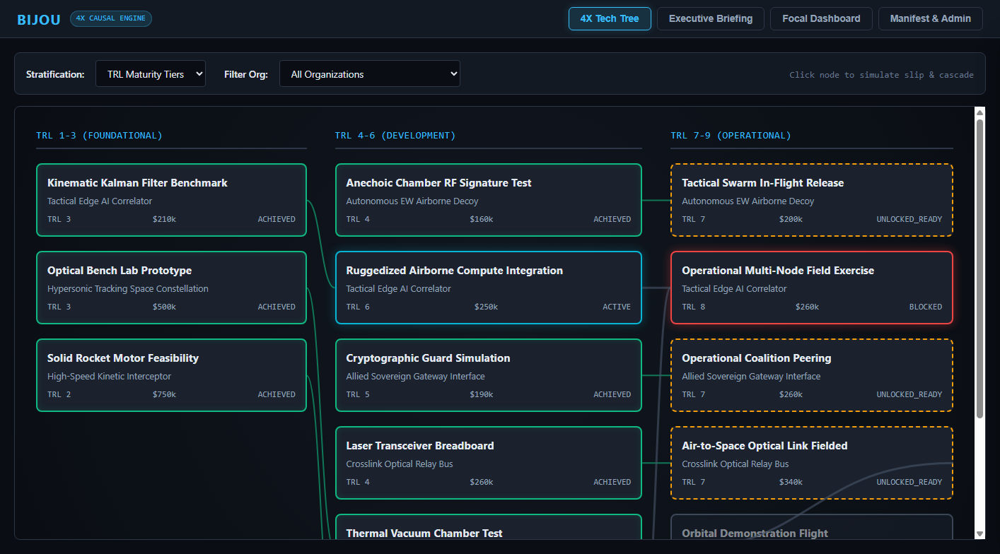
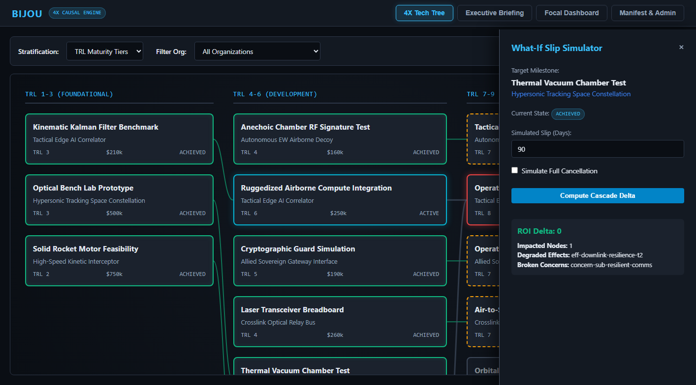
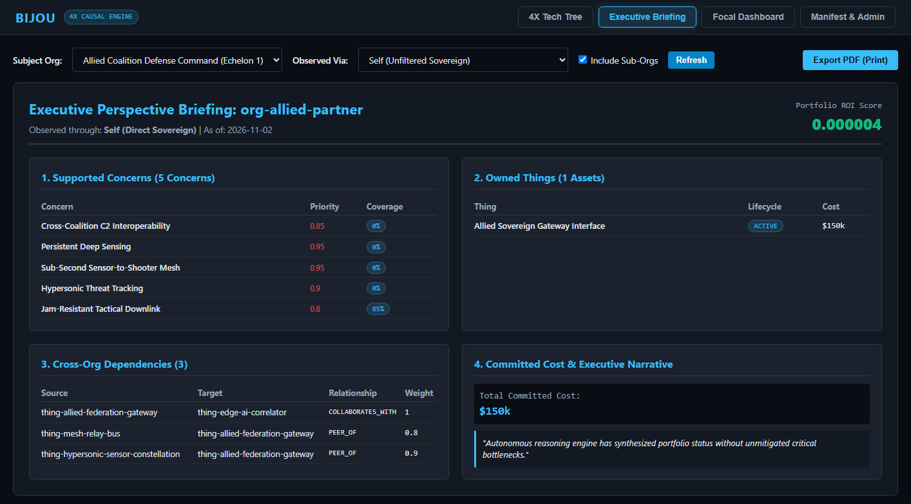
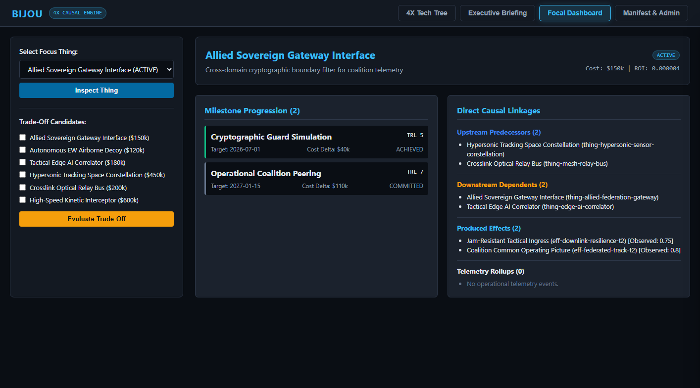
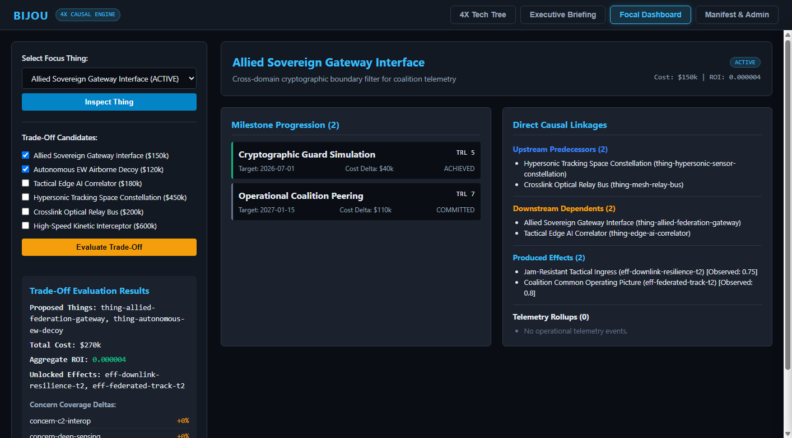
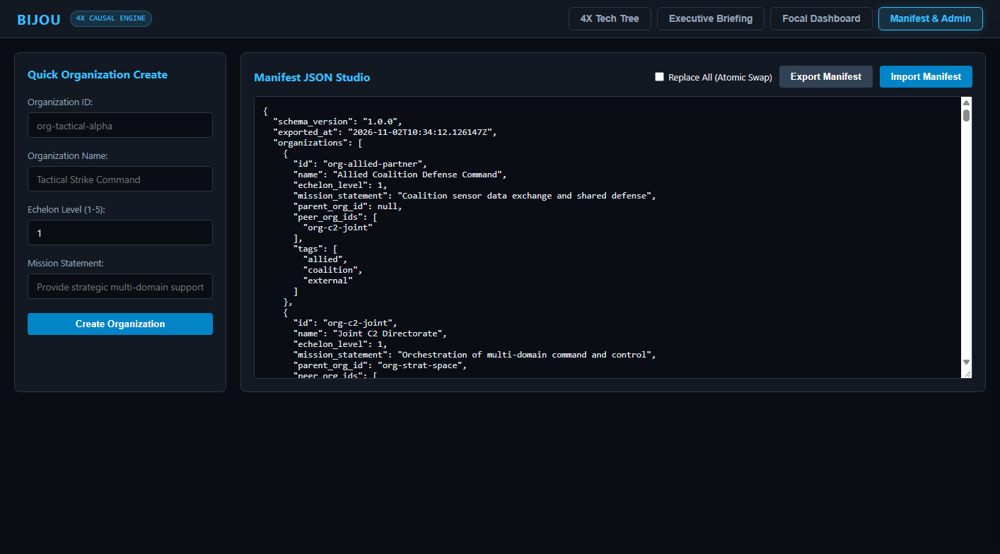

# Bijou User Guide

Comprehensive guide to modeling, analyzing, and navigating complex capital acquisition portfolios and technology roadmaps with **Bijou**.

---

## Table of Contents

1. [Introduction & Mental Model](#1-introduction--mental-model)
2. [Domain Ontology](#2-domain-ontology)
   - [Organizations & Echelons](#organizations--echelons)
   - [Strategic Concerns & Priorities](#strategic-concerns--priorities)
   - [Things & Lifecycle Statuses](#things--lifecycle-statuses)
   - [Milestones & TRL Maturity](#milestones--trl-maturity)
   - [Causal Gates & Mechanisms](#causal-gates--mechanisms)
   - [Strategic & Operational Effects](#strategic--operational-effects)
3. [Critical Path Slack & Slip Dynamics](#3-critical-path-slack--slip-dynamics)
4. [The 4 Decision-Support Lenses](#4-the-4-decision-support-lenses)
   - [Lens 1: 4X Stratified Tech Tree Canvas](#lens-1-4x-stratified-tech-tree-canvas)
   - [What-If Milestone Slip Simulator Drawer](#what-if-milestone-slip-simulator-drawer)
   - [Lens 2: Executive Multi-Perspective 1-Slide Briefing](#lens-2-executive-multi-perspective-1-slide-briefing)
   - [Lens 3: Single-Thing Focal Ego-Network & Tradeoff Matrix](#lens-3-single-thing-focal-ego-network--tradeoff-matrix)
   - [Lens 4: Manifest JSON Studio & Entity Administration](#lens-4-manifest-json-studio--entity-administration)
5. [CLI & Runtime Modes](#5-cli--runtime-modes)
6. [Reference Dataset Walkthrough](#6-reference-dataset-walkthrough)

---

## 1. Introduction & Mental Model

Traditional portfolio planning tools treat technology programs as linear Gantt charts or isolated cost centers. In reality, large-scale systems (such as defense architectures, aerospace constellations, and industrial networks) are **non-linear, multi-echelon causal graphs**.

A 60-day slip on an optical transceiver breadboard may seem inconsequential in isolation, but if that transceiver is a critical prerequisite for a satellite bus launch, which in turn feeds an automated fire-control correlation gate, the slip triggers a cascade that degrades strategic hypersonic tracking capability and leaves multi-billion-dollar interceptors locked and inactive.

**Bijou** operationalizes this reality:
- It maps explicit causal prerequisites, combinatorial gates, and operational telemetry streams.
- It computes Critical Path Method (CPM) schedule slack: minor slips are absorbed by schedule buffers, while critical-path violations transition downstream dependencies to `BLOCKED` states.
- It calculates the precise **Return on Investment (ROI) delta** and strategic concern coverage impact across the entire portfolio.

---

## 2. Domain Ontology

Bijou's data model is expressed through strict Pydantic Data Transfer Objects (DTOs).

### Organizations & Echelons

Organizations represent sovereign entities, commands, or functional directorates responsible for programs and strategic goals:
- **`echelon_level`**: Integer hierarchy indicator:
  - **Level 0**: Strategic Enterprise (e.g., Strategic Space Command).
  - **Level 1**: Operational Directorate (e.g., Joint C2 Directorate).
  - **Level 2**: Tactical Wing / Task Force (e.g., Tactical Airborne ISR Wing, Strike Group).
  - **Level 3+**: Squadron / Unit level.
- **`parent_org_id`**: Direct sovereign lineage link. When evaluating briefings with `include_descendants=true`, Bijou dynamically resolves the Directed Acyclic Graph (DAG) across both `parent_org_id` attributes and explicit `PARENT_OF` graph edges.

### Strategic Concerns & Priorities

Concerns represent top-level strategic objectives, operational mission needs, or capability gaps:
- **`priority`**: Normalized weight in $[0.0, 1.0]$. A priority of $0.95$ indicates mission-critical status.
- **`target_metric_sla`**: Numerical target threshold (e.g., 99.5% track uptime).
- **`coverage_score`**: Computed percentage $[0\%, 100\%]$ indicating the degree to which active Things and achieved Effects currently satisfy the concern.

### Things & Lifecycle Statuses

A **Thing** is a tangible capital asset, software platform, satellite constellation, sensor payload, or research initiative:
- **`lifecycle`**:
  - `PROPOSED`: Candidate initiative undergoing evaluation.
  - `ACTIVE`: Funded initiative currently in development or deployment.
  - `DELIVERED`: Fielded operational asset.
  - `DIVESTED`: Retired or decommissioned asset.
- **`estimated_cost`**: Total program cost in currency units (used as the denominator in portfolio ROI calculations).
- **`risk_factor`**: Risk multiplier $\ge 1.0$ discounting ROI efficiency.

### Milestones & TRL Maturity

Milestones mark distinct deliverables and developmental gating events within a Thing:
- **`trl`**: Technology Readiness Level (integer $1$ to $9$).
- **`sequence_index`**: Chronological order within the Thing ($0, 1, 2, \dots$). Preceding milestones are implicit prerequisites of subsequent milestones within the same Thing.
- **`target_date`**: Planned completion date.
- **`actual_date`**: Actual historical completion date (or `null` if unachieved).
- **`state` (Computed)**:
  - `ACHIEVED`: Verified complete on or before the analysis `as_of_date`.
  - `ACTIVE`: Currently in progress; all upstream prerequisites are achieved.
  - `UNLOCKED_READY`: Prerequisites complete; eligible for funding/work to commence.
  - `LOCKED`: Upstream prerequisites are not yet achieved.
  - `BLOCKED`: Explicitly cancelled or upstream prerequisite slipped past this milestone's target date.

### Causal Gates & Mechanisms

A **Causal Gate** aggregates multiple milestone or Thing contributors into a single operational yield $[0.0, 1.0]$:
1. **`ADDITIVE`**:
   $$\text{Yield} = \min\left(1.0, \sum_{c \in \text{achieved}} w_c\right)$$
   Yield scales proportionally with the sum of achieved contributor weights.
2. **`COMBINATORIAL_AND`**:
   $$\text{Yield} = \begin{cases} 1.0 & \text{if all contributors are ACHIEVED} \\ 0.0 & \text{otherwise} \end{cases}$$
   All-or-nothing synchronization point. If even one prerequisite slips or locks, yield drops to zero.
3. **`THRESHOLD_K_OF_N`**:
   $$\text{Yield} = \begin{cases} 1.0 & \text{if } |\text{achieved}| \ge k \\ 0.0 & \text{otherwise} \end{cases}$$
   Requires at least $k$ out of $n$ contributors to be achieved before unlocking.

### Strategic & Operational Effects

Effects are capabilities unlocked by Causal Gates:
- **Strategic Effects (Tier 1)**: Directly map to strategic concerns via weighted satisfaction links.
- **Operational Effects (Tier 2)**: Driven by real-time event telemetry aggregated via DuckDB. Accumulators include `SUM`, `AVG`, `MIN`, `MAX`, and `LAST`.
- **Federated Virtual Effects (Tier 3)**: Cross-boundary metrics federated via HTTP gateways.

---

## 3. Critical Path Slack & Slip Dynamics

Bijou implements true Critical Path Method (CPM) slack-aware date propagation:
1. When simulating a slip on milestone $M$, its effective date shifts by $\Delta_{\text{days}}$.
2. Downstream milestones evaluate the arrival date of all upstream prerequisites in topological sort order:
   - **Slack Absorbed**: If predecessor effective date $\le$ downstream target date, the downstream milestone transitions to `LOCKED` (awaiting upstream completion) without a schedule violation.
   - **Schedule Violated**: If predecessor effective date $>$ downstream target date, a schedule violation occurs, and the downstream milestone transitions to `BLOCKED`.
3. If an achieved milestone slips into the simulated future ($> \text{as\_of\_date}$), it gracefully transitions to `ACTIVE`.

---

## 4. The 4 Decision-Support Lenses

### Lens 1: 4X Stratified Tech Tree Canvas

The 4X Tech Tree provides a gamified, intuitive matrix representation of all technology nodes across the portfolio.



#### Features:
- **Stratification Modes**:
  - **TRL Maturity Tiers**: Groups nodes by Foundational (TRL 1-3), Development (TRL 4-6), and Operational (TRL 7-9).
  - **Fiscal Eras**: Groups nodes into semi-annual fiscal tranches (H1/H2).
  - **Topological Depth**: Renders columns strictly by DAG predecessor dependency depth.
- **SVG Connector Overlay**: Renders orthogonal Bézier connector paths between dependent nodes without external library dependencies.
- **Upstream Spine Highlighting**: Hovering over any milestone card recursively highlights all its upstream prerequisite nodes and connector lines while dimming unrelated nodes.

---

### What-If Milestone Slip Simulator Drawer

Clicking any milestone card in the Tech Tree slides open the What-If Simulator Drawer.



#### Usage:
1. Select the number of slip days using the numerical input (e.g., 90 days).
2. Optionally check **Simulate Full Cancellation** to model project termination.
3. Click **Compute Cascade Delta**.
4. The engine instantly computes:
   - **ROI Delta**: Portfolio efficiency change.
   - **Impacted Nodes**: Count and list of affected milestone state transitions.
   - **Degraded Effects**: Capabilities compromised by the slip.
   - **Broken Concerns**: Strategic goals no longer adequately covered.

---

### Lens 2: Executive Multi-Perspective 1-Slide Briefing

Designed for flag officers, executives, and portfolio review boards, this lens synthesizes multi-billion-dollar portfolios into a single landscape slide.



#### The 4 Quadrants:
1. **Supported Concerns**: Table of aligned strategic concerns with priority level and current coverage percentage.
2. **Owned Things**: Inventory of funded assets, lifecycle stages, and program costs under the selected organization.
3. **Cross-Org Dependencies**: External dependencies crossing sovereign boundaries, indicating external risk vectors.
4. **Committed Cost & Executive Narrative**: Total financial exposure alongside an automated strategic gap analysis.

#### Exporting to PDF:
Click **Export PDF (Print)**. Bijou's CSS includes dedicated `@media print` and `@page { size: landscape; margin: 0; }` stylesheets to generate a clean, single-page presentation slide directly from the browser print dialog.

---

### Lens 3: Single-Thing Focal Ego-Network & Tradeoff Matrix

Focuses on a single capital asset to examine its local 2-hop ecosystem and evaluate portfolio tradeoffs.



#### Components:
- **Milestone Progression**: Status and cost delta across all internal milestones.
- **Direct Causal Linkages**: Upstream predecessor Things, downstream dependents, and produced capabilities.
- **DuckDB Telemetry Rollups**: Live operational telemetry metrics ingested via DuckDB, tracking event count and aggregated SLA thresholds.

#### Portfolio Trade-Off Evaluation:
Select two or more candidate Things in the sidebar and click **Evaluate Trade-Off**:



Bijou evaluates the candidate combination and displays:
- Aggregate portfolio cost.
- Aggregate ROI efficiency score.
- Unlocked effects and capabilities.
- Concern coverage deltas ($+\Delta\%$) for each strategic objective.

---

### Lens 4: Manifest JSON Studio & Entity Administration

Provides direct, atomic data management and quick provisioning.



#### Capabilities:
- **Quick Organization Create**: Rapidly define new organizational units with ID, Name, Echelon Level, and Mission Statement.
- **Export Manifest**: Generates a byte-level serialized JSON representation of the entire active portfolio.
- **Atomic Import Swap**: Paste or modify manifest JSON and click **Import Manifest**. Checking **Replace All** executes an atomic database rollback and replacement.

---

## 5. CLI & Runtime Modes

Bijou includes a unified Command-Line Interface (`bijou`):

```bash
# Start standalone server (Web GUI + REST API) on default port 8000
bijou --mode standalone --port 8000

# Start in API-only headless mode
bijou --mode api-only --port 8080

# Specify custom persistence backends
bijou --mode standalone --db-uri sqlite:///production_portfolio.db --duckdb-path production_telemetry.duckdb

# Enable AI reasoning synthesis via AuraRouter
bijou --mode standalone --enable-reasoning --aurarouter-url http://aurarouter:8000
```

---

## 6. Reference Dataset Walkthrough

Bijou comes packaged with a realistic, multi-domain defense reference dataset in `datasets/`:

1. **`datasets/joint_isr_architecture.yaml`**:
   - **5 Organizations**: Strategic Space Command (Echelon 0), Joint C2 Directorate (Echelon 1), Tactical Airborne ISR Wing (Echelon 2), Tactical Strike Group (Echelon 2), and Allied Coalition Defense Command.
   - **5 Strategic Concerns**: Persistent Deep Sensing, Hypersonic Threat Tracking, Cross-Coalition C2 Interoperability, Sub-Second Sensor-to-Shooter Mesh, Jam-Resistant Tactical Downlink.
   - **6 Things**: Space Constellation, Optical Relay Bus, Edge AI Correlator, Tactical Interceptor, EW Decoy, Allied Gateway.
   - **14 Milestones**, **3 Causal Gates**, and **18 Graph Edges**.
2. **`datasets/satellite_cascade_telemetry.jsonl`**:
   - 60 sequential operational telemetry events recording optical dwell times, kinematic Mach tracks, and fire-control solution calculations.

To ingest the reference dataset at any time:
```bash
bijou-ingest --manifest datasets/joint_isr_architecture.yaml --telemetry datasets/satellite_cascade_telemetry.jsonl
```
